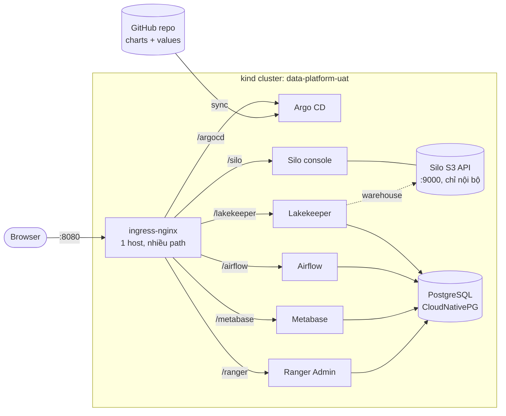

# data-platform-k8s-demo

Data platform chạy trên [kind](https://kind.sigs.k8s.io/), quản lý bằng
Argo CD (app-of-apps). Tất cả UI dùng **chung một host**, mỗi app một path,
đi qua ingress-nginx. Chart được vendor sẵn trong repo, cấu hình được tách
theo môi trường (hiện có **UAT**).

```text
UAT: http://data-uat.127.0.0.1.nip.io:8080/<app>
```

`nip.io` tự resolve `*.127.0.0.1.nip.io` về `127.0.0.1`, không cần sửa
`/etc/hosts`.

## Kiến trúc



| Path | App | Chart | Cách chạy dưới subpath |
|---|---|---|---|
| `/argocd` | Argo CD 3.6 | `charts/argo-cd` | `server.rootpath` + `server.basehref`, không strip prefix |
| `/airflow/` | Apache Airflow 3.2 | `charts/airflow` | `[api] base_url`, không strip prefix |
| `/metabase/` | Metabase 0.63 | `charts/metabase` (local) | `MB_SITE_URL`, ingress strip `/metabase` |
| `/lakekeeper/ui/` | Lakekeeper 0.15 | `charts/lakekeeper` | `LAKEKEEPER__UI__LAKEKEEPER_URL` + `X-Forwarded-Prefix`, ingress strip `/lakekeeper` |
| `/silo/` | Silo console ([MinIO fork](https://silo.pigsty.io)) | `charts/silo` (local) | `MINIO_BROWSER_REDIRECT_URL`, ingress strip `/silo` |
| `/ranger/` | Apache Ranger Admin 2.9 | `charts/ranger-admin` (local) | Tomcat `ranger.contextName=/ranger`, không strip prefix |

Endpoint chỉ dùng trong cluster (không đi qua ingress):

| Service | Endpoint |
|---|---|
| Silo S3 API | `http://silo.silo.svc:9000` |
| Lakekeeper Iceberg catalog | `http://lakekeeper.lakekeeper.svc:8181/catalog` |
| Ranger policy manager (cho plugin) | `http://ranger-admin.ranger.svc:6080/ranger` |
| PostgreSQL | `pg-rw.postgres.svc:5432` |

StarRocks và Vault không có trong stack: cổng SQL của StarRocks là TCP (không
route theo path được) và UI của Vault không hỗ trợ base path.

## Chạy nhanh

```bash
ENV=uat ./scripts/bootstrap.sh      # cluster + secrets + ingress + Argo CD + root app
kubectl --context kind-data-platform-uat -n argocd get applications -w
ENV=uat ./scripts/credentials.sh    # in URL và tài khoản đăng nhập
```

Lần đầu mất khoảng 20-25 phút, phần lớn là thời gian kéo image.

## Cấu trúc repo

```text
charts/
  airflow/ argo-cd/ cloudnative-pg/ ingress-nginx/ lakekeeper/   chart upstream (vendor, pin version)
  postgres-cluster/ silo/ metabase/ ranger-admin/                chart local
  platform-apps/                                                 app-of-apps: sinh Application cho 1 môi trường
values/common/<app>.yaml          values dùng chung mọi môi trường
environments/
  uat/
    env.sh                        tên cluster, host, port (cho scripts)
    kind-cluster.yaml             kind cluster của UAT
    platform-apps.yaml            danh sách app, wave, repo, revision
    values/<app>.yaml             override riêng UAT (host, URL, dung lượng...)
scripts/
  bootstrap.sh                    dựng 1 môi trường từ đầu
  apply-app.sh                    tạo Application cho 1 app (cài từng bước)
  render.sh                       render offline mọi app giống Argo CD
  vendor-charts.sh                cập nhật chart upstream
  credentials.sh / destroy.sh
docs/                             hướng dẫn từng bước
```

Mỗi app được render từ `charts/<chart>` với hai lớp values, lớp sau đè lớp
trước:

```text
values/common/<app>.yaml  ->  environments/<env>/values/<app>.yaml
```

## Hướng dẫn từng bước

| # | Bước | Nội dung |
|---|---|---|
| 0 | [Chuẩn bị & cấu trúc](docs/00-prerequisites.md) | Công cụ, charts, môi trường, thêm môi trường mới |
| 1 | [kind cluster](docs/01-kind-cluster.md) | Tạo cluster, vì sao dùng port 8080 |
| 2 | [Secrets](docs/02-secrets.md) | Sinh mật khẩu thành Kubernetes Secret |
| 3 | [ingress-nginx](docs/03-ingress-nginx.md) | Một host, nhiều path, rewrite |
| 4 | [Argo CD](docs/04-argocd.md) | Cài Argo CD dưới `/argocd`, app-of-apps |
| 5 | [PostgreSQL](docs/05-postgres.md) | CloudNativePG operator + cluster dùng chung |
| 6 | [Silo](docs/06-silo.md) | Object storage, console qua `/silo` |
| 7 | [Lakekeeper](docs/07-lakekeeper.md) | Iceberg REST catalog, UI qua `/lakekeeper` |
| 8 | [Airflow](docs/08-airflow.md) | Airflow 3 qua `/airflow` |
| 9 | [Metabase](docs/09-metabase.md) | BI qua `/metabase` |
| 10 | [Ranger](docs/10-ranger.md) | Ranger Admin qua `/ranger` |
| 11 | [Kiểm tra & xử lý sự cố](docs/11-verify-troubleshoot.md) | Checklist, lỗi thường gặp, dừng/xoá lab |

## Secrets

`scripts/bootstrap.sh` sinh toàn bộ mật khẩu và key thành Kubernetes Secret.
Repo không chứa thông tin nhạy cảm nào, values chỉ tham chiếu tên secret.
Chạy lại script thì giữ nguyên giá trị cũ. Chi tiết ở
[docs/02-secrets.md](docs/02-secrets.md).
