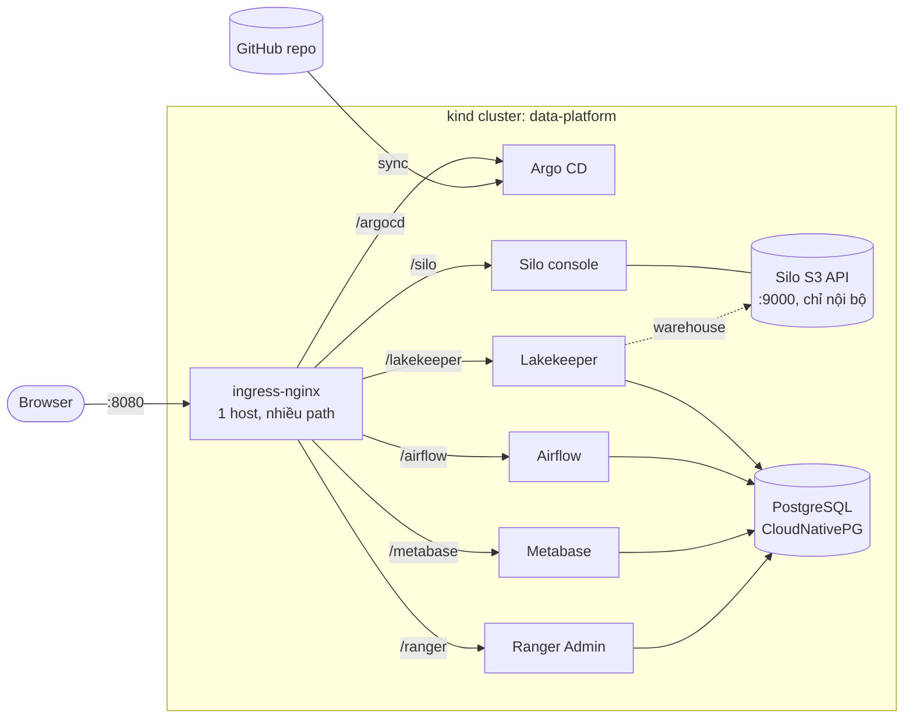

# data-platform-k8s-demo

Data platform chạy local trên [kind](https://kind.sigs.k8s.io/), quản lý bằng
Argo CD (app-of-apps). Tất cả UI dùng **chung một host**, mỗi app một path,
đi qua ingress-nginx.

```text
http://data.127.0.0.1.nip.io:8080/<app>
```

`nip.io` tự resolve `data.127.0.0.1.nip.io` về `127.0.0.1`, không cần sửa
`/etc/hosts`.

## Kiến trúc



| Path | App | Cách chạy dưới subpath |
|---|---|---|
| `/argocd` | Argo CD 3.6 | `server.rootpath` + `server.basehref`, không strip prefix |
| `/airflow/` | Apache Airflow 3.2 (LocalExecutor) | `[api] base_url`, không strip prefix |
| `/metabase/` | Metabase 0.63 | `MB_SITE_URL`, ingress strip `/metabase` |
| `/lakekeeper/ui/` | Lakekeeper 0.15 (Iceberg REST catalog) | `LAKEKEEPER__UI__LAKEKEEPER_URL` + `X-Forwarded-Prefix`, ingress strip `/lakekeeper` |
| `/silo/` | Silo console ([MinIO fork](https://silo.pigsty.io)) | `MINIO_BROWSER_REDIRECT_URL`, ingress strip `/silo` |
| `/ranger/` | Apache Ranger Admin 2.9 | Tomcat `ranger.contextName=/ranger`, không strip prefix |

Endpoint chỉ dùng trong cluster (không đi qua ingress):

| Service | Endpoint |
|---|---|
| Silo S3 API | `http://silo.silo.svc:9000` |
| Lakekeeper Iceberg catalog | `http://lakekeeper.lakekeeper.svc:8181/catalog` |
| Ranger policy manager (cho plugin) | `http://ranger-admin.ranger.svc:6080/ranger` |
| PostgreSQL | `pg-rw.postgres.svc:5432` |

StarRocks và Vault không có trong stack: cổng SQL của StarRocks là TCP (không
route theo path được) và UI của Vault không hỗ trợ base path.

## Chạy nhanh (1 lệnh)

```bash
./scripts/bootstrap.sh     # cluster + secrets + ingress-nginx + Argo CD + root app
kubectl --context kind-data-platform -n argocd get applications -w
./scripts/credentials.sh   # in URL và tài khoản đăng nhập
```

Lần đầu mất khoảng 20-25 phút, phần lớn là thời gian kéo image.

## Hướng dẫn từng bước

Nếu muốn hiểu từng thành phần, làm theo thứ tự trong `docs/`. Mỗi bước apply
**một** Argo CD Application và kiểm tra trước khi sang bước tiếp theo.

| # | Bước | Nội dung |
|---|---|---|
| 0 | [Chuẩn bị](docs/00-prerequisites.md) | Công cụ, tài nguyên, cấu trúc repo |
| 1 | [kind cluster](docs/01-kind-cluster.md) | Tạo cluster, vì sao dùng port 8080 |
| 2 | [Secrets](docs/02-secrets.md) | Sinh mật khẩu thành Kubernetes Secret |
| 3 | [ingress-nginx](docs/03-ingress-nginx.md) | Một host, nhiều path, rewrite |
| 4 | [Argo CD](docs/04-argocd.md) | Cài Argo CD dưới `/argocd` |
| 5 | [PostgreSQL](docs/05-postgres.md) | CloudNativePG operator + cluster dùng chung |
| 6 | [Silo](docs/06-silo.md) | Object storage, console qua `/silo` |
| 7 | [Lakekeeper](docs/07-lakekeeper.md) | Iceberg REST catalog, UI qua `/lakekeeper` |
| 8 | [Airflow](docs/08-airflow.md) | Airflow 3 qua `/airflow` |
| 9 | [Metabase](docs/09-metabase.md) | BI qua `/metabase` |
| 10 | [Ranger](docs/10-ranger.md) | Ranger Admin qua `/ranger` |
| 11 | [Kiểm tra & xử lý sự cố](docs/11-verify-troubleshoot.md) | Checklist, lỗi thường gặp, dừng/xóa lab |

## Cấu trúc repo

```text
kind/cluster.yaml        kind cluster, host 8080/8443 -> ingress
scripts/                 bootstrap, credentials, destroy
argocd/root.yaml         root Application (app-of-apps)
argocd/apps/             mỗi thành phần một Application
values/                  Helm values cho chart upstream
manifests/               manifest thuần (postgres, silo, metabase, ranger)
docs/                    hướng dẫn từng bước
```

## Secrets

`scripts/bootstrap.sh` sinh toàn bộ mật khẩu và key thành Kubernetes Secret.
Repo không chứa thông tin nhạy cảm nào, manifest chỉ tham chiếu tên secret.
Chạy lại script thì giữ nguyên giá trị cũ. Chi tiết ở
[docs/02-secrets.md](docs/02-secrets.md).
