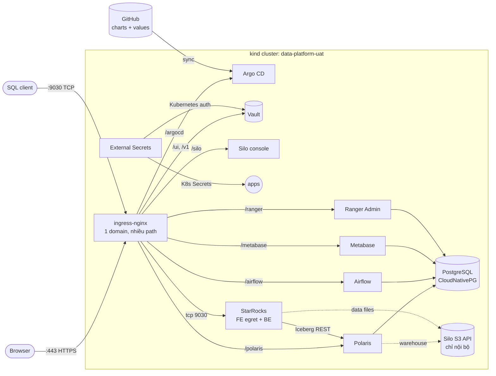

# data-platform-k8s-demo

Data platform chạy trên [kind](https://kind.sigs.k8s.io/), quản lý bằng Argo CD
(GitOps, app-of-apps), secret nằm trong **Vault** và được đồng bộ vào Kubernetes
bằng **External Secrets Operator**. Tất cả UI dùng chung **một domain HTTPS**,
mỗi app một path. Chart được vendor sẵn trong repo, cấu hình tách theo môi
trường (hiện có **UAT**).

```text
https://data-uat.127.0.0.1.nip.io/<app>
```

`nip.io` tự resolve `*.127.0.0.1.nip.io` về `127.0.0.1`; cert do
[mkcert](https://github.com/FiloSottile/mkcert) cấp và trình duyệt tin được.

## Kiến trúc



| Path | App | Chart | Cách chạy chung domain |
|---|---|---|---|
| `/argocd` | Argo CD 3.6 | `charts/argo-cd` | `server.rootpath` + `server.basehref` |
| `/ui`, `/v1` | Vault 2.0 | `charts/vault` | Path cố định của Vault, không trùng app khác |
| `/airflow/` | Airflow 3.2 | `charts/airflow` | `[api] base_url` |
| `/metabase/` | Metabase 0.63 | `charts/metabase` (local) | `MB_SITE_URL`, ingress strip prefix |
| `/polaris/` | Apache Polaris 1.9 (Iceberg REST, đăng nhập + RBAC có sẵn) | `charts/polaris`, `charts/polaris-console` (local) | API `/polaris/api` và console `/polaris/`, ingress strip prefix; console build kèm patch base path |
| `/silo/` | Silo console | `charts/silo` (local) | `MINIO_BROWSER_REDIRECT_URL`, ingress strip prefix |
| `127.0.0.1:9030` (TCP) | StarRocks 4.1.7, FE vá bảo mật [egret-starrocks](https://github.com/egret-data/egret-starrocks) | `charts/starrocks` + operator | Giao thức MySQL không route theo path: đi qua ingress-nginx `tcp-services` |
| `/ranger/` | Ranger Admin 2.9 | `charts/ranger-admin` (local) | Tomcat `ranger.contextName` |

## Bắt đầu

Làm theo **tutorial**: [docs/00-overview.md](docs/00-overview.md). Tutorial
cài từng thành phần theo đúng thứ tự phụ thuộc, có checkpoint sau mỗi bước:

1. Chuẩn bị máy → 2. kind cluster → 3. Cache image (registry mirror) → 4. TLS
   (mkcert) → 5. ingress-nginx → 6. Argo CD → 7. Vault → 8. External Secrets →
   9. PostgreSQL → 10-14. Silo, Polaris, Airflow, Metabase, Ranger → 15. StarRocks → 16. Kiểm tra

Hoặc chạy cả tutorial bằng một lệnh:

```bash
mkcert -install                     # một lần: cho trình duyệt tin CA local
ENV=uat ./scripts/bootstrap.sh
kubectl --context kind-data-platform-uat -n argocd get applications -w
ENV=uat ./scripts/credentials.sh
```

## Cấu trúc repo

```text
charts/                   chart upstream (vendor, pin version) + chart local
  platform-apps/          app-of-apps: sinh Application cho một môi trường
  platform-secrets/       ClusterSecretStore (Vault) + ExternalSecret cho mọi secret
values/common/            values dùng chung
environments/uat/         env.sh, kind-cluster.yaml, platform-apps.yaml, values/<app>.yaml
scripts/                  bootstrap, registry-cache, tls, apply-app, vault-setup, render, ...
docs/                     tutorial từng bước + tham khảo
```

Chi tiết: [docs/17-reference.md](docs/17-reference.md).

## Secrets

Repo không chứa secret nào. `scripts/vault-setup.sh` sinh giá trị ngẫu nhiên vào
Vault (`secret/platform/*`), External Secrets tạo Kubernetes Secret cho từng
app. Unseal key và root token của Vault được lưu trong cluster để tự unseal lại,
**chỉ phù hợp cho lab**.
