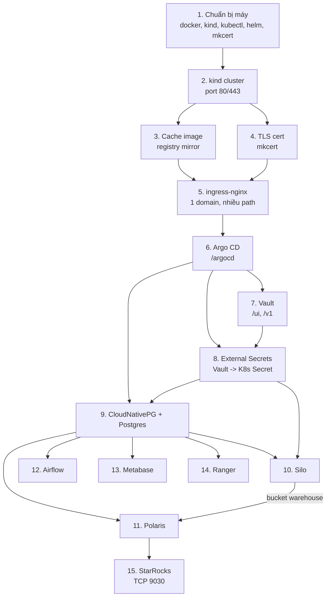

# Tutorial: dựng data platform trên kind, từng bước

Tutorial này dựng môi trường **UAT** từ một máy trống: một cluster kind, một
domain `https://data-uat.127.0.0.1.nip.io`, mỗi app một path, secret nằm trong
Vault, Argo CD quản lý mọi thứ từ Git.

## Bạn sẽ có gì ở cuối tutorial

| URL | App |
|---|---|
| `https://data-uat.127.0.0.1.nip.io/argocd` | Argo CD: GitOps, quản lý toàn bộ app |
| `https://data-uat.127.0.0.1.nip.io/ui` | Vault: nơi lưu mọi secret |
| `https://data-uat.127.0.0.1.nip.io/airflow/` | Airflow 3 |
| `https://data-uat.127.0.0.1.nip.io/metabase/` | Metabase |
| `https://data-uat.127.0.0.1.nip.io/polaris/` | Apache Polaris (Iceberg REST catalog, có đăng nhập + RBAC) |
| `https://data-uat.127.0.0.1.nip.io/silo/` | Silo console (object storage, fork của MinIO) |
| `https://data-uat.127.0.0.1.nip.io/ranger/` | Apache Ranger Admin |
| `mysql -h 127.0.0.1 -P 19030` | StarRocks (SQL qua TCP, đọc/ghi Iceberg trên Polaris) |

## Thứ tự cài và vì sao

Mỗi tầng chỉ cài được khi tầng bên dưới đã chạy:

| Bước | Cài gì | Phụ thuộc | Lý do phải ở vị trí này |
|---|---|---|---|
| 1 | Công cụ trên máy | - | |
| 2 | kind cluster | Docker | Port 80/443 chỉ map được lúc tạo cluster |
| 3 | Cache image | cluster | Registry cache cạnh kind: dựng lại cluster không phải tải lại image từ internet |
| 4 | TLS cert | cluster | ingress-nginx cần cert ngay khi khởi động |
| 5 | ingress-nginx | cert | Mọi UI (kể cả Argo CD) đi qua ingress |
| 6 | Argo CD | ingress | Từ đây mọi app được cài từ Git |
| 7 | Vault | Argo CD | Nơi chứa secret; phải init/unseal trước khi app đọc được |
| 8 | External Secrets | Vault | Đồng bộ secret từ Vault thành K8s Secret cho app |
| 9 | Postgres | secrets | Metadata DB của Polaris, Airflow, Metabase, Ranger |
| 10-14 | Các app | Postgres, secrets | Cài theo thứ tự nào cũng được |
| 15 | StarRocks | Polaris, Silo | Catalog Iceberg `lakehouse` trỏ vào Polaris |

## Hai cách làm

- **Theo tutorial** (khuyến nghị lần đầu): làm từng bước 1 → 16, kiểm tra xong
  mới sang bước sau. Mỗi bước app chỉ là một lệnh `./scripts/apply-app.sh <app>`.
- **Một lệnh**: `ENV=uat ./scripts/bootstrap.sh` làm toàn bộ các bước trên.
  Script tự chạy `vault-setup.sh` và tạo Application `root`. Root cài app theo
  **wave** đúng thứ tự trong bảng trên, đợi wave trước Healthy rồi mới sang
  wave sau (xem [bước 6](06-argocd.md#wave-cài-lần-lượt-không-cài-dồn)).

Thời gian dựng toàn bộ UAT khoảng 20-25 phút (đo trên Docker Desktop macOS,
8 CPU), phần lớn là chờ các app khởi động.

## Mục lục

| # | Bước |
|---|---|
| 1 | [Chuẩn bị máy](01-prerequisites.md) |
| 2 | [Tạo kind cluster](02-kind-cluster.md) |
| 3 | [Cache image để pull nhanh](03-preload-images.md) |
| 4 | [TLS cert với mkcert](04-tls.md) |
| 5 | [ingress-nginx](05-ingress-nginx.md) |
| 6 | [Argo CD + app-of-apps](06-argocd.md) |
| 7 | [Vault](07-vault.md) |
| 8 | [External Secrets: Vault → Kubernetes](08-external-secrets.md) |
| 9 | [PostgreSQL (CloudNativePG)](09-postgres.md) |
| 10 | [Silo](10-silo.md) |
| 11 | [Apache Polaris](11-polaris.md) |
| 12 | [Airflow](12-airflow.md) |
| 13 | [Metabase](13-metabase.md) |
| 14 | [Ranger](14-ranger.md) |
| 15 | [StarRocks](15-starrocks.md) |
| 16 | [Kiểm tra cuối & xử lý sự cố](16-verify-troubleshoot.md) |
| - | [Tham khảo: cấu trúc repo, môi trường, chart](17-reference.md) |

Tiếp theo: [1. Chuẩn bị máy](01-prerequisites.md)
