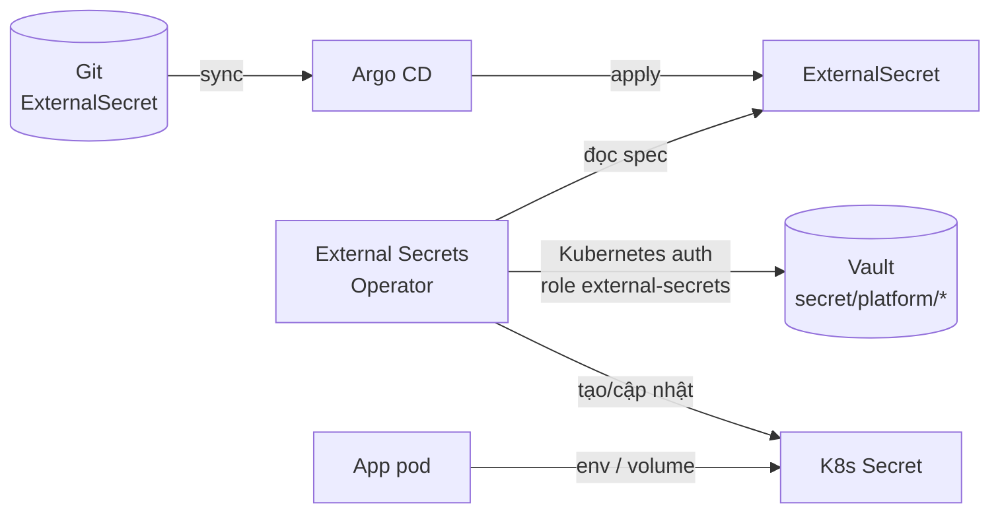

# Bước 8: External Secrets: Vault → Kubernetes

## Argo CD tích hợp Vault thế nào



- Git chỉ chứa **chỗ tham chiếu** tới secret (`ExternalSecret`: lấy key nào ở
  path nào trong Vault), không chứa giá trị.
- Argo CD sync `ExternalSecret` như mọi resource khác, và hiển thị health của
  nó (`SecretSynced`).
- External Secrets Operator (ESO) đăng nhập Vault bằng ServiceAccount của nó
  (Kubernetes auth), đọc giá trị rồi tạo Secret thường cho app dùng.
- Đổi giá trị trong Vault thì ESO tự cập nhật Secret (mặc định mỗi giờ).

Đây là cách tài liệu Argo CD khuyến nghị: secret không đi qua repo-server và
không nằm trong cache của Argo CD, khác với cách dùng plugin
(argocd-vault-plugin).

## 8.1 Cài External Secrets Operator

```bash
ENV=uat ./scripts/apply-app.sh external-secrets --wait
kubectl -n external-secrets get pods
```

## 8.2 Kết nối Vault và khai báo secret

```bash
ENV=uat ./scripts/apply-app.sh platform-secrets
```

Chart `charts/platform-secrets` sinh ra:

**Một `ClusterSecretStore`** trỏ vào Vault:

```yaml
apiVersion: external-secrets.io/v1
kind: ClusterSecretStore
metadata:
  name: vault
spec:
  provider:
    vault:
      server: http://vault.vault.svc:8200
      path: secret
      version: v2
      auth:
        kubernetes:
          mountPath: kubernetes
          role: external-secrets
          serviceAccountRef: { name: external-secrets, namespace: external-secrets }
```

**Mỗi Secret một `ExternalSecret`**, khai báo trong
`values/common/platform-secrets.yaml`:

```yaml
secrets:
  # Secret basic-auth cho CloudNativePG: lấy password từ Vault, username cố định
  - name: pg-role-airflow
    namespace: postgres
    type: kubernetes.io/basic-auth
    data:
      password: { key: platform/postgres/airflow, property: password }
    template:
      username: airflow

  # Ghép chuỗi connection từ CÙNG password đó, cho Airflow
  - name: airflow-metadata
    namespace: airflow
    data:
      password: { key: platform/postgres/airflow, property: password }
    template:
      connection: "postgresql://airflow:{{ .password }}@pg-rw.postgres.svc.cluster.local:5432/airflow?sslmode=disable"
```

Nhờ `template`, mỗi giá trị chỉ nằm **một chỗ** trong Vault mà vẫn sinh được
nhiều Secret với định dạng khác nhau (`basic-auth` cho CNPG, URL connection cho
Airflow).

## 8.3 Danh sách Secret được tạo

| Namespace | Secret | Lấy từ Vault |
|---|---|---|
| `postgres` | `pg-superuser`, `pg-role-<app>` | `platform/postgres/*` |
| `polaris` | `polaris-persistence`, `polaris-token-broker`, `polaris-storage`, `polaris-root` | `platform/postgres/polaris`, `platform/polaris`, `platform/silo` |
| `starrocks` | `starrocks-root`, `starrocks-setup`, `starrocks-ranger` | `platform/starrocks`, `platform/polaris`, `platform/silo`, `platform/ranger` |
| `airflow` | `airflow-metadata`, `airflow-fernet-key`, `airflow-api-secret-key`, `airflow-jwt-secret`, `airflow-admin`, `airflow-git-ssh`, `airflow-demo-dwh`, `airflow-logs-connection` | `platform/postgres/airflow`, `platform/airflow`, `platform/airflow-git`, `platform/starrocks`, `platform/demo-dwh`, `platform/silo` |
| `metabase` | `metabase-db` | `platform/postgres/metabase` |
| `ranger` | `ranger-secrets` | `platform/postgres/ranger`, `platform/ranger` |
| `silo` | `silo-root` | `platform/silo` |

## Checkpoint

```bash
kubectl get clustersecretstore vault
# NAME    AGE   STATUS   CAPABILITIES   READY
# vault   1m    Valid    ReadWrite      True

kubectl get externalsecret -A
# mọi dòng: STATUS SecretSynced, READY True
```

Nếu `ClusterSecretStore` không `Valid`:

| Thông báo | Nguyên nhân |
|---|---|
| `permission denied` | Chưa chạy `vault-setup.sh`, hoặc role/policy sai |
| `Vault is sealed` | Vault vừa restart: chạy lại `vault-setup.sh` |
| `connection refused` | Pod `vault-0` chưa chạy |

## Đổi một secret

```bash
TOKEN=$(kubectl -n vault get secret vault-init -o jsonpath='{.data.root-token}' | base64 -d)
kubectl -n vault exec -i vault-0 -- env VAULT_TOKEN="$TOKEN" \
  vault kv patch -mount=secret platform/airflow admin-password=MyNewPass123
kubectl -n airflow annotate externalsecret airflow-admin force-sync="$(date +%s)" --overwrite
```

App đọc secret qua env thì cần restart pod để nhận giá trị mới. Riêng mật khẩu
DB: CNPG tự đổi mật khẩu role khi secret `pg-role-*` thay đổi.

Tiếp theo: [9. PostgreSQL](09-postgres.md)
