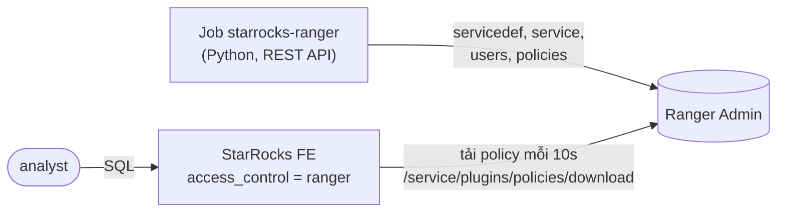

# Bước 15: StarRocks

StarRocks là query engine MPP nói giao thức MySQL. Trong stack này nó đọc và
ghi bảng Iceberg qua **Polaris** (catalog `lakehouse`), dữ liệu nằm trên **Silo**.

| | Địa chỉ |
|---|---|
| SQL từ máy bạn | `mysql -h 127.0.0.1 -P 19030 -u root -p` |
| SQL trong cluster | `starrocks-fe-service.starrocks.svc:9030` |
| Mật khẩu `root` | Vault `secret/platform/starrocks` → `root-password` (`ENV=uat ./scripts/credentials.sh`) |

## Image

| Thành phần | Image | Ghi chú |
|---|---|---|
| FE | `ghcr.io/egret-data/egret-starrocks-fe:4.1.7-egret.4` | Image chính thức 4.1.7 với `fe-core`/`fe-spi` build lại kèm các bản vá bảo mật của [egret-starrocks](https://github.com/egret-data/egret-starrocks) (Iceberg metadata tables, mask/row filter qua `PREPARE`/HTTP SQL API/Arrow Flight, `FILES()`, `SHOW CREATE CATALOG`, ...) |
| BE | `starrocks/be-ubuntu:4.1.7` | Image chính thức: không bản vá nào đụng tới BE/CN |
| Operator | `starrocks/operator:v1.11.8` | |

Danh sách bản vá có trong image FE: `/opt/starrocks/fe/EGRET-PATCHES.txt`.
Các bản vá này có tác dụng khi bật `access_control = ranger` (mục 15.3).

## SQL không đi qua path

Giao thức MySQL là TCP thuần, không có HTTP path, nên không thể route theo
`/starrocks` như các app khác. Thay vào đó cổng 9030 đi thẳng qua ingress-nginx
(`tcp-services`):

```yaml
# environments/uat/values/ingress-nginx.yaml
tcp:
  "9030": starrocks/starrocks-fe-service:9030
```

```yaml
# environments/uat/kind-cluster.yaml (cổng phải có từ lúc tạo cluster)
- containerPort: 9030
  hostPort: 19030        # trên máy dùng 19030, tránh đụng StarRocks local ở 9030
  listenAddress: "127.0.0.1"
```

Với giao thức MySQL, port trên máy khác port trong node không gây vấn đề gì
(không có redirect như HTTP), nên chọn port nào cũng được.

Web UI của FE (cổng 8030) không hỗ trợ subpath và không cần cho việc dùng hằng
ngày, nên không đưa ra ingress. Cần thì port-forward:

```bash
kubectl -n starrocks port-forward svc/starrocks-fe-service 8030:8030
```

## Làm

```bash
ENV=uat ./scripts/vault-setup.sh                        # seed secret/platform/starrocks
ENV=uat ./scripts/apply-app.sh starrocks-operator --wait
ENV=uat ./scripts/apply-app.sh starrocks-ranger --wait     # trước StarRocks: policy cho root phải có sẵn
ENV=uat ./scripts/apply-app.sh starrocks --wait
ENV=uat ./scripts/apply-app.sh starrocks-setup --wait
```

| App | Chart | Nội dung |
|---|---|---|
| `starrocks-operator` | `charts/starrocks-operator` (vendor `operator` 1.11.8) | Operator + CRD `StarRocksCluster` |
| `starrocks` | `charts/starrocks` (vendor 1.11.8) | 1 FE + 1 BE, `default_replication_num = 1` |
| `starrocks-ranger` | `charts/starrocks-ranger` | Job đăng ký StarRocks trong Ranger (servicedef, service, user, policy) + ConfigMap cấu hình plugin cho FE |
| `starrocks-setup` | `charts/starrocks-setup` | Job: đặt mật khẩu root → chờ BE sống → tạo (hoặc tạo lại) catalog `lakehouse` → tạo user → bảng demo |

### Mật khẩu root

Chart có sẵn Job `initPassword`, nhưng chính chart ghi chú rằng với Argo CD Job
này sẽ chạy lại ở mọi lần sync. Vì vậy:

- `initPassword.enabled: true`, `isInstall: false`: operator vẫn đưa mật khẩu
  (secret `starrocks-root`) vào FE/BE qua `MYSQL_PWD` cho probe và vận hành.
- Job `starrocks-setup` tự đặt mật khẩu: nếu `root` còn đăng nhập được với mật
  khẩu rỗng thì chạy `SET PASSWORD`, ngược lại bỏ qua.

### Catalog Iceberg trên Polaris

```sql
CREATE EXTERNAL CATALOG IF NOT EXISTS lakehouse PROPERTIES (
  'type' = 'iceberg',
  'iceberg.catalog.type' = 'rest',
  'iceberg.catalog.uri' = 'http://polaris.polaris.svc:8181/api/catalog',
  'iceberg.catalog.warehouse' = 'lakehouse',
  'iceberg.catalog.security' = 'oauth2',
  'iceberg.catalog.oauth2.credential' = '<client_id>:<client_secret>',
  'iceberg.catalog.oauth2.scope' = 'PRINCIPAL_ROLE:ALL',
  'iceberg.catalog.vended-credentials-enabled' = 'false',
  'aws.s3.endpoint' = 'http://silo.silo.svc:9000',
  'aws.s3.region' = 'us-east-1',
  'aws.s3.enable_path_style_access' = 'true',
  'aws.s3.access_key' = '...',
  'aws.s3.secret_key' = '...'
);
```

- **`vended-credentials-enabled = false`**: Polaris chạy với `stsUnavailable`
  nên không cấp credential S3 tạm. Thiếu dòng này thì tạo bảng báo
  `Credential vending was requested for table ..., but no credentials are available`.
  StarRocks dùng key Silo của chính nó (`aws.s3.*`).
- **Đổi cấu hình catalog**: lệnh `CREATE` nằm trong ConfigMap `starrocks-setup`.
  Job ghi checksum của nó vào `COMMENT` của catalog; khi checksum khác, Job
  `DROP` rồi tạo lại catalog. Catalog chỉ là con trỏ tới Polaris, bảng và dữ
  liệu không bị ảnh hưởng. Tên Job chứa checksum của script, nên mọi thay đổi
  đều làm Job chạy lại.

Lab dùng principal `root` của Polaris và key root của Silo cho gọn. Môi trường
thật nên tạo một principal Polaris riêng cho StarRocks (chỉ có quyền trên
catalog cần dùng) và một user Silo riêng.

## 15.3 Phân quyền bằng Apache Ranger

FE chạy với `access_control = ranger`: **mọi** quyền (kể cả của `root`) do
Ranger quyết định, không dùng `GRANT` của StarRocks.



### Phía Ranger: `charts/starrocks-ranger`

Ranger 2.9 **chưa có sẵn** service definition `starrocks`. Job
`starrocks-ranger` dùng file chính thức `ranger-servicedef-starrocks.json`
(repo StarRocks, tag `4.1.7`, `conf/ranger/`) và làm, idempotent:

1. Đăng ký service definition `starrocks` (resource `catalog` → `database` →
   `table` → `column`, cùng `view`, `materialized_view`, `function`, `system`,
   `user`...; có row filter và data mask). Đặt `implClass` cho lookup. Nếu
   definition đã có mà khác (so sánh không phụ thuộc thứ tự) thì cập nhật bằng
   `PUT`, đúng như tài liệu StarRocks yêu cầu.
2. Tạo hoặc cập nhật service `starrocks` (plugin trong FE đọc theo tên này),
   kết nối lookup bằng user `ranger_lookup`.
3. Tạo user trong Ranger (`root`, `analyst`, `ranger_lookup`).
4. Với superuser (`root`): mỗi nhánh resource một policy, gồm mọi quyền hợp lệ
   cho nhánh đó. Khi tạo service, Ranger tự sinh các policy mặc định trên `*`
   (`all - catalog`, ...) và không cho tạo policy trùng resource, nên Job
   **thay thế** các policy mặc định đó (chỉ những policy tên `all - ...`).
   Policy tự quản lý khác mà trùng resource thì Job dừng với lỗi, không ghi đè.
5. Policy khai báo trong `values/common/starrocks-ranger.yaml`.
6. Chạy *Test Connection* và in kết quả.

Policy demo:

```yaml
policies:
  - name: analyst-read-orders
    type: access
    resources: { catalog: lakehouse, database: sales, table: orders, column: "*" }
    users: [analyst]
    accesses: [select]
  - name: analyst-orders-hanoi-only
    type: rowFilter
    resources: { catalog: lakehouse, database: sales, table: orders }
    users: [analyst]
    filter: "city = 'Hanoi'"
  - name: analyst-mask-amount
    type: mask
    resources: { catalog: lakehouse, database: sales, table: orders, column: amount }
    users: [analyst]
    maskType: MASK_NULL
```

Thêm hoặc sửa policy: sửa file này rồi push. Job có tên theo checksum, nên sẽ
chạy lại và cập nhật policy. Cũng có thể sửa trực tiếp trên Ranger UI
(<https://data-uat.127.0.0.1.nip.io/ranger/> → service **starrocks**), nhưng
khi Job chạy lại, các policy cùng tên sẽ bị ghi đè bằng giá trị trong Git.

### Lookup trên Ranger UI (autocomplete, Test Connection)

Đây là bước "Optional: install ranger-starrocks-plugin" trong
[tài liệu StarRocks](https://docs.starrocks.io/docs/administration/user_privs/authorization/ranger_plugin/#optional-install-ranger-starrocks-plugin).
Lab đưa nó vào một **image Ranger riêng**, `images/ranger-admin`:

```dockerfile
FROM docker.io/apache/ranger:2.9.0
COPY --chown=ranger:ranger ranger-starrocks-plugin.jar mysql-connector-j.jar \
     /opt/ranger/admin/ews/webapp/WEB-INF/classes/ranger-plugins/starrocks/
```

| Jar | Nguồn (pin trong `images/ranger-admin/image.env`, kiểm tra sha256) |
|---|---|
| `ranger-starrocks-plugin-3.0.0-SNAPSHOT.jar` | `releases.starrocks.io/resources/` (link "Ranger plugin" trên trang download community), bytecode Java 8 |
| `mysql-connector-j-9.3.0.jar` | Maven Central |

`scripts/build-images.sh` tải jar, kiểm tra checksum, build rồi push
`localhost:5001/ranger-admin:2.9.0-starrocks.1`; `values/common/ranger.yaml`
trỏ chart Ranger vào image này. Bootstrap tự build nếu registry local chưa có.

Service `starrocks` kết nối StarRocks bằng user `ranger_lookup` (mật khẩu ở
Vault `secret/platform/starrocks` → `ranger-lookup-password`, do
`starrocks-setup` tạo). StarRocks chỉ liệt kê những object mà user có quyền,
và không có quyền nào chỉ cho xem metadata, nên user này được **đọc**
(`usage` trên catalog, `select` trên cột) nhưng không được ghi. Quyền đó là
một policy item nằm **trong** policy superuser của hai nhánh tương ứng, vì
Ranger chỉ cho một policy trên mỗi bộ resource.

Kết quả: *Test Connection* báo `Connection test successful`, và khi tạo policy,
các ô **StarRocks Catalog / Database / Table / Column** gợi ý tên lấy thẳng từ
StarRocks (`lakehouse` → `sales` → `orders` → `id`, `city`, `amount`, ...).

### Phía StarRocks

```yaml
# values/common/starrocks.yaml
starrocksFESpec:
  config: |
    ...
    access_control = ranger
  configMaps:                           # từ charts/starrocks-ranger
    - name: starrocks-ranger-plugin
      mountPath: /opt/starrocks/fe/conf/ranger-starrocks-security.xml
      subPath: ranger-starrocks-security.xml
    - name: starrocks-ranger-plugin
      mountPath: /opt/starrocks/fe/conf/ranger-starrocks-audit.xml
      subPath: ranger-starrocks-audit.xml
```

`ranger-starrocks-security.xml` trỏ plugin vào
`http://ranger-admin.ranger.svc:6080/ranger`, service `starrocks`, poll mỗi
10 giây, cache policy trong `fe/meta/ranger-policycache`. Audit đang tắt (lab
không có Solr/OpenSearch).

User `analyst` được `starrocks-setup` tạo trong StarRocks, mật khẩu ở Vault
`secret/platform/starrocks` → `analyst-password`. Quyền của nó chỉ đến từ Ranger.

### Plugin tải policy không cần Kerberos

Lab không có Kerberos, nên plugin gọi endpoint download không xác thực. Ranger
mặc định từ chối (`Unauthenticated access not allowed`), và khi đó FE **không có
policy nào**: mọi user trừ `root` bị từ chối hết. UAT bật cờ chỉ dành cho các
endpoint download:

```yaml
# values/common/ranger.yaml
siteProperties:
  ranger.admin.allow.unauthenticated.download.access: "true"
```

Phải dùng đúng cờ `...download.access`. Cờ rộng hơn
`ranger.admin.allow.unauthenticated.access` **không** có tác dụng ở đây, vì
`ranger-admin-default-site.xml` đặt riêng cờ download là `false`. Môi trường
thật nên dùng Kerberos cho plugin.

### Kết quả

```text
root    → SELECT * FROM lakehouse.sales.orders
| 1 | Hanoi  | 120.5 |
| 2 | Saigon |    99 |
| 3 | Danang | 45.25 |
| 4 | Hanoi  |    30 |

analyst → cùng câu lệnh (row filter city = 'Hanoi', amount MASK_NULL)
| 1 | Hanoi | NULL |
| 4 | Hanoi | NULL |

analyst → SELECT COUNT(*) FROM lakehouse.sales.orders$files
ERROR 5210: metadata table orders$files is not available because a row access
or column masking policy applies to table orders for this user     ← bản vá egret 0001

analyst → CREATE TABLE lakehouse.sales.hack (id BIGINT)
ERROR 5204: Access denied; you need ... CREATE TABLE ... on DATABASE sales
```

## Checkpoint

```bash
PW=$(kubectl -n starrocks get secret starrocks-root -o jsonpath='{.data.password}' | base64 -d)
mysql -h 127.0.0.1 -P 19030 -u root -p"$PW" -e "SHOW BACKENDS\G" | grep -E 'Alive|Version'
```

Ghi và đọc một bảng Iceberg (dữ liệu nằm trên Silo, metadata trong Polaris):

```sql
CREATE DATABASE IF NOT EXISTS lakehouse.sales;
CREATE TABLE IF NOT EXISTS lakehouse.sales.orders (id BIGINT, city STRING, amount DOUBLE);
INSERT INTO lakehouse.sales.orders VALUES (1,'Hanoi',120.5),(2,'Saigon',99.0),(3,'Danang',45.25),(4,'Hanoi',30.0);
SELECT city, COUNT(*) n, SUM(amount) total FROM lakehouse.sales.orders GROUP BY city ORDER BY total DESC;
SELECT snapshot_id, operation FROM lakehouse.sales.orders$snapshots;
```

```text
+--------+------+-------+
| city   | n    | total |
+--------+------+-------+
| Hanoi  |    2 | 150.5 |
| Saigon |    1 |    99 |
| Danang |    1 | 45.25 |
+--------+------+-------+
```

Sau đó vào Polaris Console → **Catalogs → lakehouse → sales** sẽ thấy bảng
`orders`; file dữ liệu nằm trong bucket `warehouse` của Silo.

Kiểm tra phân quyền (`analyst` chỉ thấy dòng Hanoi, `amount` là NULL):

```bash
APW=$(kubectl -n starrocks get secret starrocks-setup -o jsonpath='{.data.analyst-password}' | base64 -d)
mysql -h 127.0.0.1 -P 19030 -u analyst -p"$APW" -e 'SELECT * FROM lakehouse.sales.orders'
```

Kiểm tra FE đúng là image đã vá:

```bash
kubectl -n starrocks exec starrocks-fe-0 -- cat /opt/starrocks/fe/EGRET-PATCHES.txt
```

## Metabase

Image Metabase chính thức không có driver StarRocks. Có thể thử thêm database
kiểu **MySQL** trỏ vào `starrocks-fe-service.starrocks.svc:9030`
(chưa kiểm chứng trong lab này). Driver StarRocks riêng cần một image Metabase
build kèm driver.

Tiếp theo: [16. Kiểm tra cuối](16-verify-troubleshoot.md)
